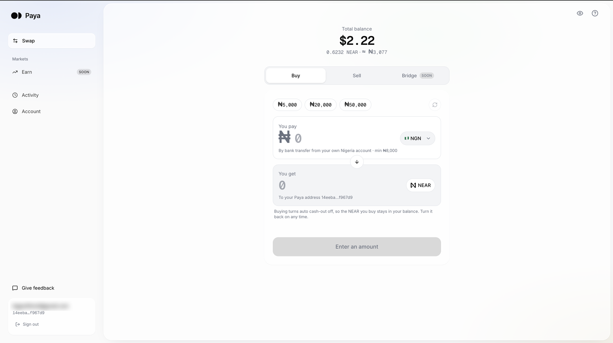

# Paya

> ## 🧑‍⚖️ Judges: try Paya live
>
> **Open [usepaya.xyz/app](https://www.usepaya.xyz/app). No access code needed.**
>
> - **Sign in with your email** for your own Paya account and NEAR address: buy NEAR with a bank transfer, cash out to a Nigerian bank, swap tokens.
> - **Or connect a NEAR wallet** (HOT, Meteor, Nightly, …) under **Wallet swap** to swap tokens in your own wallet via NEAR Intents.
>
> Paya is live with real money: buying, cashing out and swapping move real funds.



Move money between NEAR and your bank, both ways. Sign in with your email, get your own NEAR address, buy NEAR with a bank transfer, and cash NEAR out to your bank account — by hand or automatically.

Built for the [NEAR Hackathon](https://nearhackathon.com) — Track 08, Real-World Money.

## How it works

```
Buy:   bank transfer ──PAJ──▶ USDC (Solana) ──swap──▶ NEAR in your Paya address
Sell:  NEAR in your Paya address ──swap──▶ USDC (Solana) ──PAJ──▶ your bank account
```

- **Frontend** ([frontend/](frontend/)): landing page and the swap app — wallet connect via NEAR Connect, email verification with the payout network, bank accounts with real account-holder names, a live quote with every fee shown, and progress until the money lands.
- **Relay** ([services/relay/](services/relay/)): quotes, places the PAJ order and the exact-output 1Click swap, hands the wallet one transaction to sign, tracks both legs. Never holds funds.
- **Admin console** ([admin/](admin/)): internal, password-protected dashboard of every cash-out with its full timeline, explorer links and an audit log, for support and disputes. Runs separately on port 3001.
- **Contracts** ([contracts/](contracts/)): the earlier deposit-account design (factory + locked per-user accounts). Not used by the current wallet flow; kept for a "send NEAR from an exchange" mode.

## Run it locally

```bash
# 1. relay
cd services/relay && cp .env.example .env   # set PAJ_API_KEY
npm install && npm run dev                   # http://localhost:8787

# 2. frontend
cd frontend && npm install && npm run dev    # http://localhost:3000 → /app
```

With `LIVE_ORDERS=false` (the default) everything is real except the money movement: sign-in, banks, name lookup and quotes hit the live services, and swaps are simulated. Set `LIVE_ORDERS=true` in the relay to place real orders (mainnet NEAR, real payouts).

## Deploy

| Part | Where | Settings |
|---|---|---|
| Frontend | Vercel | Root directory `frontend`, framework Next.js. Env: `NEXT_PUBLIC_RELAY_URL=https://<your relay>` |
| Relay | Railway / Render / Fly (always-on) | Root `services/relay`, uses its `Dockerfile`. Env: `PAJ_API_KEY`, `LIVE_ORDERS`, `FEE_PERCENT`, `CORS_ORIGINS=https://<your vercel domain>`, `PUBLIC_URL=https://<your relay>`. Mount a volume at `/data`. |

The relay polls in-flight swaps every few seconds, so it can't run as Vercel serverless functions.

## Pricing

```
NEAR ──1Click──▶ USDC on Solana     0.25 % platform fee + solver spread + ≈0.22 USDC Solana withdrawal fee
USDC ──PAJ──▶ local currency        PAJ's live off-ramp rate (₦1,383/USD at the time of writing)
Paya fee                            FEE_PERCENT of the USDC (default 0.5 %), charged through PAJ
```

The quote on the swap card shows each line. 1Click adds a ~1 % buffer on the NEAR side to guarantee delivery; anything unused is refunded to the user's wallet.

## Status

- [x] Landing page
- [x] Swap app: wallet connect, email verification, live quote, recipients with verified names, progress tracking
- [x] Relay: PAJ off-ramp + 1Click exact-output, tracking, safety switch
- [x] Countries: Nigeria, Ghana, Kenya, Tanzania, South Africa (PAJ corridors)
- [ ] First live cash-out (`LIVE_ORDERS=true`, small amount)
- [ ] Bridge to Solana (tab marked Soon)
- [ ] Buy / on-ramp (tab marked Soon)
- [ ] Earn (preview UI only)
